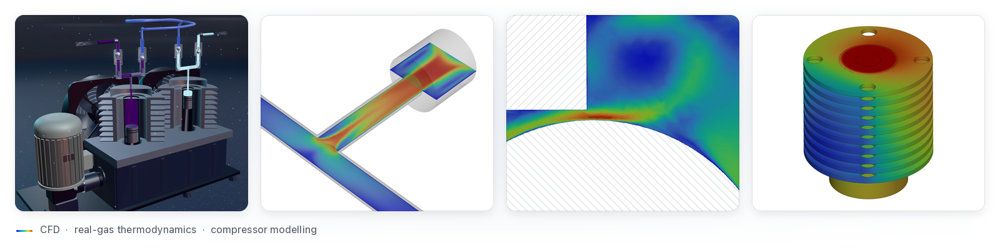

<picture>
  <source media="(prefers-color-scheme: dark)" srcset="media/banner-dark@2x.png">
  
</picture>

## Berkay Şimşek

Chemical engineer (MSc, Middle East Technical University, 2026). I model high-pressure reciprocating
compressors with 3-D CFD (ANSYS Fluent) and 0-D thermodynamic models (MATLAB, Python), test them
against a laboratory rig, and build the software that puts those models to work.

### Projects

<table>
<tr>
<td width="33%" valign="top">

<a href="https://github.com/astralisxx/logos-yb690-booster"><b>LOGOS-YB690 Booster</b></a> 
Desktop simulator and inverse-design tool for a two-stage reciprocating gas booster. Real-gas
physics core in Python/SciPy, tested against the MATLAB reference models; FastAPI, Tauri, three.js.

</td>
<td width="33%" valign="top">

<a href="https://github.com/astralisxx/reciprocating-compressor-cfd"><b>Reciprocating compressor CFD</b></a> 
MSc thesis work: transient 3-D dynamic-mesh CFD of a high-pressure nitrogen compressor cylinder, with check-valve dynamics and wall heat transfer in C UDFs.

</td>
<td width="33%" valign="top">

<a href="https://github.com/astralisxx/the-factory-showcase"><b>The Factory</b></a> 
Desktop app that runs command-line coding agents as a robot crew on an isometric ship: missions as
pipelines, approval gates, Keep/Undo, and a benchmark harness.

</td>
</tr>
<tr>
<td width="33%" valign="top">

<a href="https://github.com/astralisxx/check-valve-cfd"><b>Check valve CFD</b></a> 
Steady 3-D CFD and flow experiments of the compressor's ball check valves, matched to infer lift and effective flow area.

</td>
<td width="33%" valign="top">

<a href="https://github.com/astralisxx/compressor-heat-transfer"><b>Compressor heat transfer</b></a> 
Cool-down experiments and conjugate CFD of the finned housings give the wall heat-transfer condition for the 0-D and 3-D models.

</td>
</tr>
</table>

The source code of these projects is private.

### Research

- **Conference paper.** A. B. Şimşek, B. Erdoğan, N. B. Üner, "Computational Design of a High-Pressure
  Compressor and Its Experimental Validation", ICCHMT 2025, Lecture Notes in Mechanical Engineering,
  Springer, pp. 390-399, 2026. https://doi.org/10.1007/978-3-032-16138-3_36
- **Conference paper.** F. Turgut, A. B. Şimşek, N. B. Üner, B. Erdoğan, "Analysis of a High-Pressure
  Reciprocating Compressor Piston's 2D Simulation Utilizing Computational Fluid Dynamics", ICBASET 2024,
  The Eurasia Proceedings of Science, Technology, Engineering and Mathematics, vol. 28, pp. 352-359, 2024.
  https://doi.org/10.55549/epstem.1523562
- **MSc thesis.** "Experimental and Numerical Design of a High-Pressure Reciprocating Compressor",
  METU Chemical Engineering, 2026. Supervisor Asst. Prof. Dr. Necip Berker Üner; co-supervisor
  Dr. Barış Erdoğan (Logos Kimya).
- **Journal manuscript** on the compressor model and its validation: in preparation.

### Tools

**CFD:** ANSYS Fluent and Meshing (dynamic mesh, UDFs in C, k-omega SST, real-gas equations of state) 
**Modelling:** MATLAB (stiff ODE systems), Python (NumPy, SciPy, Cantera) 
**Software:** FastAPI, Tauri, JavaScript, three.js, Plotly, pytest, Playwright, GitHub Actions 
**Experiments:** high-pressure compressor test rig, in-cylinder pressure and mass-flow measurement

### Contact

[Google Scholar](https://scholar.google.com/citations?user=OxW7kAoAAAAJ) · Ankara, Türkiye
